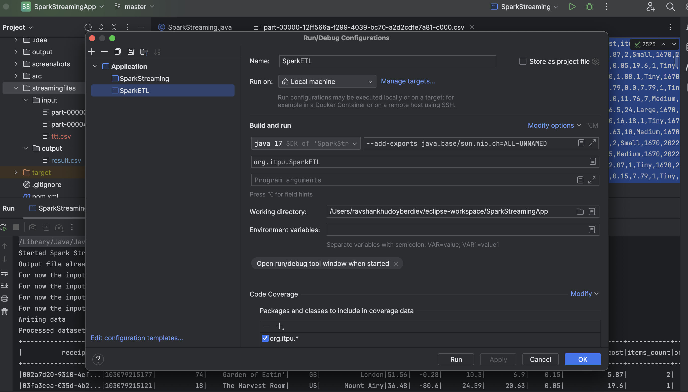
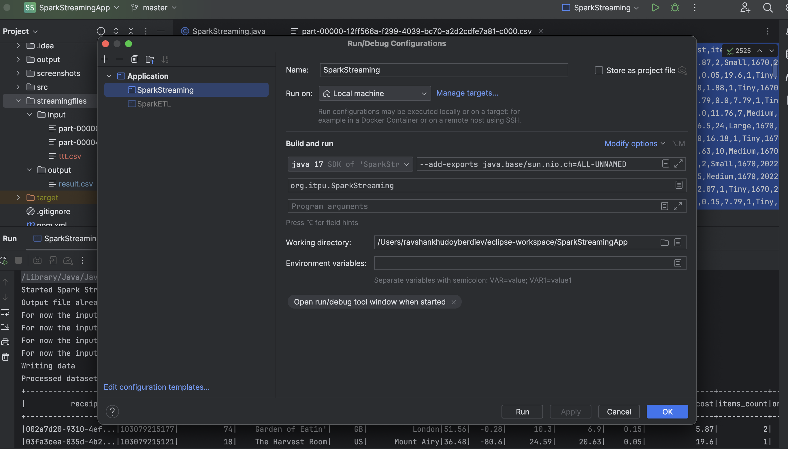
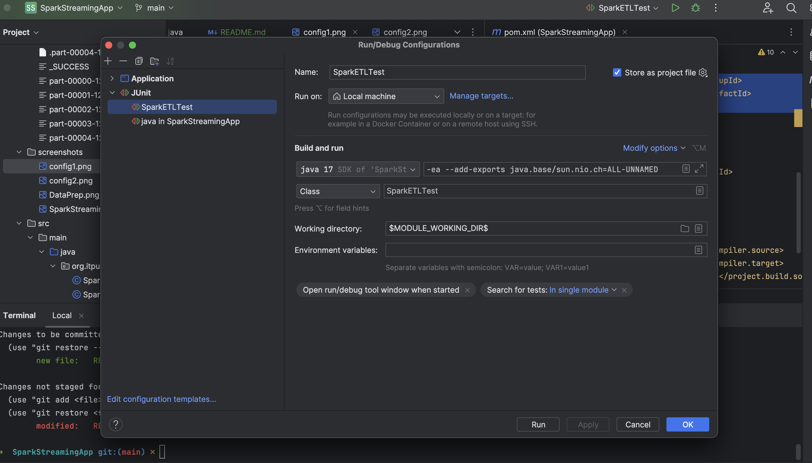
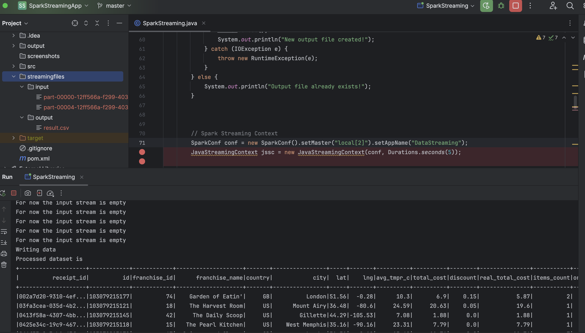
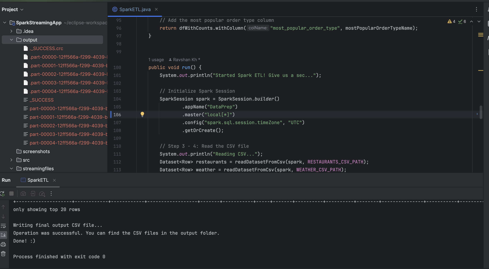
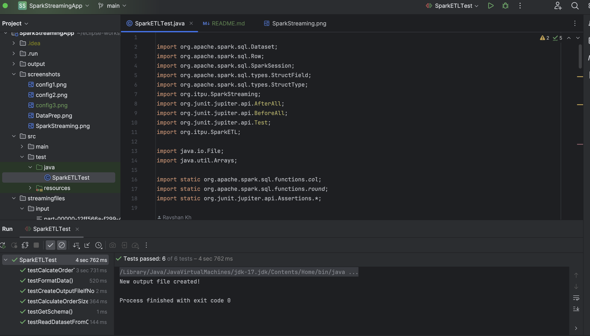

This application runs transformations on restaurant and weather CSV data files and presents final data in CSV. 
The application has two main classes so it needs to be run in the following order:
1. [SparkETL.java](./src/main/java/org/itpu/SparkETL.java). This class needs to be run first to generate the CSV files into [output folder](./output)
2. [SparkStreaming.java](./src/main/java/org/itpu/SparkStreaming.java). This class needs to be run second ASAP after CSV files were generated. We need to instantly move generated CSV file from [output folder](./output) to [streamingfiles/input folder](./streamingfiles/input). Please note the file needs to be newly created just now otherwise it won't be read by Spark Streaming. In case, it doesn't read the file you need to change the moved file dates to current datetime. 
Finally, you should get the output into [result.csv file](./streamingfiles/output/result.csv). All the newly created files that arrive into [streamingfiles/input folder](./streamingfiles/input) will be read and appended to one file - [result.csv file](./streamingfiles/output/result.csv).

# Requirements
1. Project requirements are present in Maven pom.xml file
- Spark Core 3.5.1
- Spark SQL 3.5.1
- Spark Streaming 3.5.1
- JUnit Jupiter v5.10.2
2. The project is set up to run on JDK 17
3. There are important run configurations specific to JDK 17 and Spark 3.5.1. Without them, the project might return errors on Java 17.

   
   
   

So you need to add `--add-exports java.base/sun.nio.ch=ALL-UNNAMED` VM options to both classes and JUnit.

or you can simply import [Run Configurations](.run/) into your Intellij IDEA instead.

# Project Structure
- `output/` folder contains the result of running SparkETL.java
- `streamingfiles/input/` folder contains the input files for SparkStreaming.java
- `streamingfiles/output/` folder contains the result.csv file - the result of running SparkStreaming.java
- `src/main/` folder contains the main application logic code
- `src/main/resources/` folder contains the CSV files to read or input files for weather and restaurants for SparkETL.java.
- `src/test/` folder contains JUnit tests for our application
- `screenshots/` folder contains just pictures for reporting
- `pom.xml` contains the project library requirements
- `.run/` contains the project run configurations

# Running

1. Once the above requirements were met, you can run the following class [SparkETL.java](./src/main/java/org/itpu/SparkETL.java) first.
Since it is a Spark application, you might need to wait a bit after running before you get a message as shown below. Then you can go to
[Output folder](./output) to see the generated CSV files.

2. Then, you can run the following class [SparkStreaming.java](./src/main/java/org/itpu/SparkStreaming.java).
3. Further, you can quickly drop the generated file to [streamingfiles/input folder](./streamingfiles/input) or update data metadata in existing CSV file.
Main idea is that Spark Streaming should think it is a new file created few seconds ago. Finally, you should get [result.csv file](./streamingfiles/output/result.csv) get updated with freshest information.
New data gets appended to the file so you need to open it to see the update.

# Tests

You can run tests in [SparkETLTest](./src/test/java/SparkETLTest.java).

